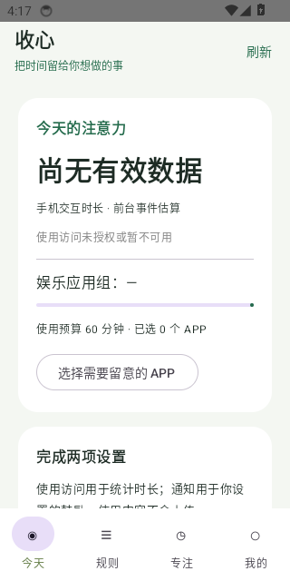
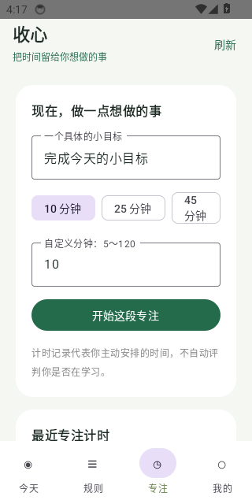
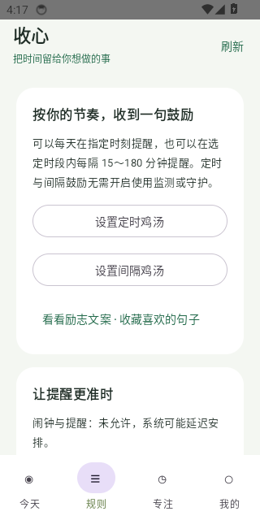
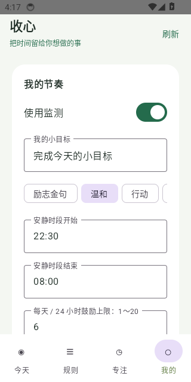
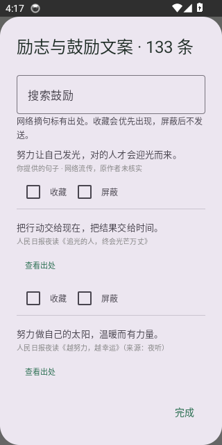

# 收心 · Android APP

看见手机使用时间，在持续刷娱乐 APP 时收到温和的提醒，再开始一段短专注。Android 原生应用，简体中文，无账号，使用记录保存在本机。

当前版本 **0.1.1**，最低 Android 10。厂商系统的后台稳定性和耗电需真机验收。

Android 14 模拟器的实际页面（默认设置，没有个人使用数据）：

| 今天 | 专注 |
|---|---|
|  |  |

| 规则 | 我的 |
|---|---|
|  |  |

励志文案与出处：



## 安装和使用

首次安装使用 [正式 APK 0.1.1](https://github.com/zhouwenp925/come_on_APP/releases/download/v0.1.1/shouxin-0.1.1-release.apk)（约 3 MB）。本地构建结果位于 `artifacts/`；后续版本从 [GitHub Releases](https://github.com/zhouwenp925/come_on_APP/releases) 下载。开发包使用独立包名，不能作为正式版更新。

1. 打开「今天」，开启使用情况访问和通知权限，选择需要留意的 APP。
2. 开启 1/2/4 小时守护，检测娱乐应用组的连续使用；通知中可以随时停止。
3. 在「规则」配置固定时间、间隔、连续使用、每日预算提醒。默认连续 15 分钟、当日预算 60 分钟；固定和间隔默认关闭。
4. 「专注」支持 10/25/45 分钟及自定义 5～120 分钟；「我的」设置目标、静默时段、鼓励风格和更新。

默认静默时段 22:30～08:00，普通提醒冷却 20 分钟，每日及滚动 24 小时最多 6 条鼓励。提醒支持稍后 10 分钟（最多两次）、今天暂停和进入专注。133 条文案包括 12 条有出处的网络摘句、用户示例和 120 条原创内容，可收藏、屏蔽，也能加入自己的短句。

只想按时收到励志鸡汤：进入「规则 → 设置定时鸡汤 / 设置间隔鸡汤」保存并开启，允许鼓励通知；Android 12+ 点击「允许准时提醒」，在系统里允许「闹钟与提醒」。不需要使用访问或守护。进入「我的」选择「励志金句」并保存，或为单条规则单独指定。默认间隔 60 分钟，从当日窗口起点锚定（09:00～21:00 时首先计划 10:00），到达上限后不再发送。若希望覆盖整段时窗，请相应调整「我的」里的上限和冷却。

文案来源和设置细节见 [励志文案与定时提醒](docs/励志文案与定时提醒.md)。摘句随安装包内置，提醒时无需联网；点击「查看出处」才打开浏览器。

本次 30 项核心测试、5 项文案测试及每个 Android 平台 4 项设备测试均通过，详见 [0.1.1 验证记录](docs/0.1.1验证记录.md)。

手机使用时长来自前台事件估算，缺失数据显示为空缺。分屏、应用分身、工作资料和多设备不纳入首版。已允许准时提醒时使用精确闹钟，未允许时使用系统普通安排；系统省电、勿扰、强制停止等状态仍可能使提醒延迟或不可见。

## 开发与构建

技术栈：Kotlin、Jetpack Compose、Room、DataStore、WorkManager、AlarmManager；用户主动开启的有时限前台服务负责实时守护。`:core` 是独立可测试的规则与事件计算模块，`:app` 接入 Android 能力。

使用完整 JDK 17+（必须包含 `javac` 和 `jlink`）、Android SDK 36、Build Tools 35.0.0 和 Gradle 8.13。Android Studio 打开项目即可同步，SDK 路径写入不提交的 `local.properties`。

Windows 可使用项目脚本：

```powershell
# 首次：下载安装工具链，在终端阅读并接受 Android SDK 许可
.\scripts\Bootstrap-Android.ps1 -AcceptSdkLicenses
# 构建开发版，执行规则测试
.\scripts\Build.ps1 -Mode Debug
# 正式版：首次生成私有签名；随后保留并沿用该签名
.\scripts\Build.ps1 -Mode Release
# 更新版本名称及递增 versionCode
.\scripts\Bump-Version.ps1 -VersionName 0.1.2
```

若网络无法下载 Gradle，可给 bootstrap 指定 `-GradleMirror`，脚本仍核验官方 SHA-256。正式版构建自动运行规则、文案测试和 Release Lint，输出 APK 及校验文件到 `artifacts/`。

Linux/macOS 或 CI：设置 JDK/SDK 后执行 `./gradlew :core:test :app:lintDebug :app:assembleDebug`。有设备/模拟器时执行 `./gradlew :app:connectedDebugAndroidTest`，验证页面导航及数据库迁移。没有 GitHub CLI 时，本地发版脚本使用 Python 3 标准库和已有 Git 登录，不增加第三方 Python 依赖。

## 保留数据的更新

正式包名固定为 `cn.shouxin.app`，版本记录统一在 `version.properties`。更新必须保持原签名且递增 `versionCode`。Room 注册显式迁移，禁止失败后清库；DataStore 设置使用稳定键。覆盖安装保留数据，卸载后重新安装不保留。

APP「我的 → 检查更新」读取本仓库最新正式 Release；用户下载后校验包名、Android 版本号和签名，有 GitHub 摘要时同时核验 SHA-256，再交给系统确认安装。下载状态可在重开 APP 后恢复。不支持静默安装或代码热更新。

已提供两条发版路径：

- **本地发版**：正式构建后运行 `scripts/Publish-Release.ps1`（使用 GitHub CLI 或已有 Git 登录），或在 GitHub Releases 网页创建 `v0.1.0`，附上 APK 和 `.sha256`。这条路径无需将签名私钥交给 CI。
- **Actions 自动发版**：自行运行 `scripts/Configure-GitHubSigning.ps1`，把本地原签名放入仓库加密 Secrets 并启用 `SIGNED_RELEASE_CI_ENABLED`，再提交版本变更并推送 `vX.Y.Z` 标签。`release.yml` 执行测试、Lint、签名构建并上传 Release。尚未启用时工作流跳过签名发布。

**请私下备份 `.signing/shouxin-release.jks` 和 `signing.properties`，不要提交、公开或重新生成。丢失它们将无法继续给已安装用户覆盖更新。** 本项目忽略这些文件、SDK、构建缓存和安装包。

## 数据与验收

原始事件保留 7 天，日汇总、提醒和专注记录保留 90 天。导出 JSON 包含设置、规则和保留期内记录；首版没有 JSON 导入恢复功能。清空记录保留规则和偏好，并阻止重新导入清空前的历史。使用明细不联网传输；主动检查和下载更新时访问 GitHub。系统备份关闭。

详见 [产品开发报告](docs/收心APP产品开发报告.md)、[开发与发布指南](docs/开发与发布指南.md)、[Android 真机验收](docs/Android真机验收.md) 和 [交付验证记录](docs/交付验证记录.md)。CI 在推送后构建开发包，运行规则测试、Lint 和 Android 10/14 模拟器测试；结果以 Actions 页面为准。
