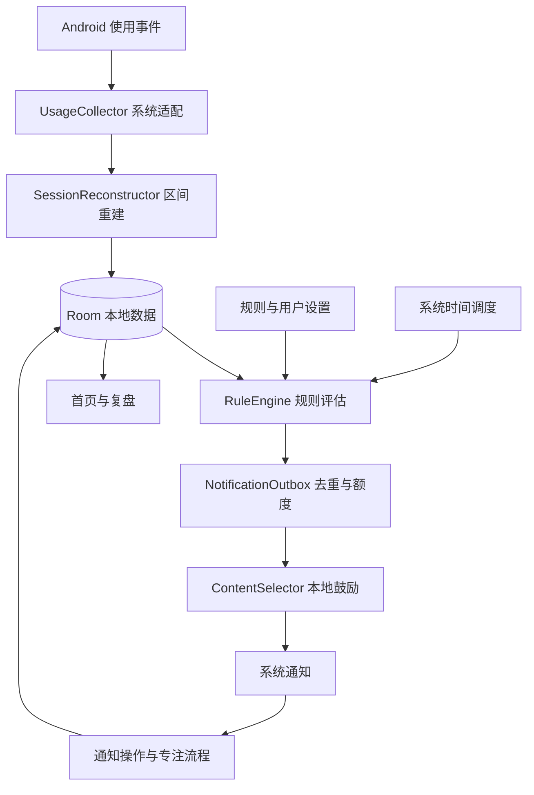

# 收心 APP 产品开发报告

**文档类型：** 产品需求说明书（PRD）与技术开发依据  
**版本：** v1.0  
**编写及资料核验日期：** 2026 年 10 月 11 日（北京时间）  
**适用对象：** 产品、UI、Android/iOS 开发、测试，以及后续辅助编程的 AI  
**产品名称：** “收心”为暂定名称，上架前另行确认名称与标识。

> 产品目标：帮助用户看见自己的手机使用情况，在容易持续刷手机的时刻收到温和、具体的提醒，并快速开始一段专注。产品可以提供监测和干预，无法保证用户一定停止娱乐，也无法在任何系统状态下保证通知准时、可见。

**阅读建议：** 第 1～9 节用于确认产品功能与交互；第 10～12 节用于编程实现；第 13～17 节用于验收、排期和启动开发。

## 1. 开发结论与当前假设

建议先开发 **Android 原生、数据保存在本机、无需登录的 MVP**。先验证使用统计与提醒，再完成用户主动开启的“实时守护时段”。iOS 采用独立的 Screen Time API 方案，不能直接复用 Android 的后台监测实现。

用户已确认 **Android 安卓优先**。本报告的首版实施、排期与验收均以 Android 为准；iOS 内容作为后续平台规划及能力差异参考，不纳入 Android MVP 的交付范围。

| 项目 | 本报告采用的假设 |
|---|---|
| 首批用户 | 希望减少无意识刷手机的成年人，首先满足个人自用 |
| 首发语言 | 简体中文 |
| 首发平台 | Android，用户已确认；建议最低 Android 10/API 29，须结合实际手机确认 |
| 使用范围 | 当前手机、当前个人用户空间；工作资料、应用分身和多设备不属于 MVP |
| 产品方式 | 用户自愿授权和控制，可暂停、关闭、撤销权限 |
| 数据与账号 | 离线可用、无需登录、使用记录默认不上传 |
| 激励内容 | 本地原创短句与用户自定义内容，首版不依赖云端 AI |
| 提醒渠道 | 系统本地通知，APP 内消息作为补充 |
| 发布渠道 | 先完成真机原型和内部试用，正式商店要求在发布前复核 |

**最先解决的技术问题：** 使用统计是否可靠、守护服务能否持续运行、通知是否可见、额外耗电是否可接受。这四项验证未通过之前，不应投入完整视觉设计或云端服务开发。

## 2. 用户问题与产品定位

用户往往是为了短暂放松打开手机，随后在短视频、资讯、社交或游戏之间切换，失去对时间的感知。普通闹钟只知道时间，不知道用户是否已经刷了很久；单纯的励志句子又可能缺乏可以立即执行的下一步。

产品定位是“个人手机使用觉察与专注行动助手”。核心体验为：

1. **看见：** 展示今天的手机交互时长、选定 APP 使用时长和趋势。
2. **察觉：** 用户设定娱乐 APP、使用阈值与需要守护的时段。
3. **提醒：** 在固定时间、间隔时间或使用达到阈值时发送一条鼓励。
4. **行动：** 从通知直接开始 10/25/45 分钟专注，或者稍后提醒。
5. **复盘：** 回顾今天的使用与专注记录，逐步调整规则。

产品不把所有手机使用都视为浪费。工作、导航、通话、学习和阅读可能是必要活动，APP 用途由用户自行标记。

### 2.1 核心用户故事

| 编号 | 用户故事 | 成功结果 |
|---|---|---|
| US-01 | 我想知道时间主要花在哪些 APP 上 | 首页能看到今天的数据与排名，且清楚标注缺失或估算 |
| US-02 | 我想在刷娱乐 APP 太久时被叫醒 | 选定应用组达到阈值后，出现有使用背景的提醒 |
| US-03 | 我想每天在学习或工作开始前被鼓励 | 可设置每天 09:00、14:00 等固定提醒 |
| US-04 | 我想隔一段时间收到提醒 | 可设置有效时段内每 30/60/90 分钟提醒 |
| US-05 | 我看到提醒后想立刻做一点正事 | 一次点击进入短专注任务，避免复杂操作 |
| US-06 | 我希望提醒语气适合我 | 可选温和、行动、目标三种风格，也能自定义 |
| US-07 | 我不想在睡觉、开会或正在专注时被打扰 | 安静时段、暂停、冷却和每日上限生效 |

### 2.2 试用效果评估

建议先邀请 5～10 名试用者，观察 14 天；这些数字是试用方案，不是已有实验结果。

- 前 3 天建立使用基线，后 11 天启用提醒；允许用户提前启用，但需记录基线不足。
- 主要结果：选定娱乐 APP 的日均使用时长，相比基线下降是否达到暂定目标 15%。只比较数据完整的日期，并注明样本量。
- 行动结果：提醒操作中“开始专注”的比例，以及随后专注完成的比例。
- 体验结果：用户每周自评“提醒有帮助”和“提醒打扰”的程度，均采用 1～5 分。
- 保护指标：提醒关闭率、额外耗电、错误触发和数据缺失率。

首轮试用用于检验产品方向，不能据此宣称必然提高自律。没有有效基线时，展示实际时长，不展示“节省了多少时间”。

## 3. 平台可行性与能力边界

### 3.1 Android

Android 可通过 `UsageStatsManager` 查询 APP 使用统计及事件，需要用户在系统设置中授予使用情况访问权限。事件历史保留有限；设备重启后尚未完成用户首次解锁等状态可能返回不可用结果，不能将其解释为使用时长为零。[Android UsageStatsManager 官方文档](https://developer.android.com/reference/android/app/usage/UsageStatsManager)

普通 `WorkManager` 周期任务的最小周期为 15 分钟，执行会受系统调度与省电影响。因此它适合补齐统计、整理日报，不适合检测“刚刚连续刷到第 10 分钟”。[PeriodicWorkRequest 官方文档](https://developer.android.com/reference/androidx/work/PeriodicWorkRequest)

实时守护的候选实现是用户从 APP 内主动开启的前台服务，运行期间保留可见状态通知。Android 14 及以上涉及相应服务类型声明；`specialUse` 只能作为经过论证的候选类型，其用途还会受到发布渠道审查，不能预先承诺一定获批。[前台服务类型](https://developer.android.com/develop/background-work/services/fgs/service-types)、[Google Play 前台服务要求](https://support.google.com/googleplay/android-developer/answer/13392821)

固定时间提醒可使用 AlarmManager。精确闹钟有单独的适用条件与权限；本产品默认采用允许延迟的提醒，并明确展示计划时间。是否增加用户选择的精确提醒，应在验证必要性和渠道要求后决定。[Android 闹钟调度](https://developer.android.com/develop/background-work/services/alarms)

### 3.2 iOS

iOS 自我管理可采用 Family Controls 的个人授权；iOS 16 引入了个人授权方式，适用于用户管理自己的设备。个人授权不提供家长控制模式下的防卸载能力。[Apple：Screen Time API 更新](https://developer.apple.com/videos/play/wwdc2022/110336/)

应用选择采用系统提供的选择界面与令牌；Device Activity 的事件阈值针对计划区间内的**累计使用量**。不能把其直接描述成 Android 方案中的“连续刷了 15 分钟”。[Family Controls](https://developer.apple.com/documentation/familycontrols)、[DeviceActivityEvent](https://developer.apple.com/documentation/deviceactivity/deviceactivityevent)

统计展示通过 DeviceActivityReport 扩展实现，受隐私沙箱限制，不应把扩展视为可随意搬运原始使用记录到主 APP 或服务器的数据接口。[DeviceActivityReport](https://developer.apple.com/documentation/deviceactivity/deviceactivityreport)

较新的 FamilyActivityData 有额外的数据访问授权、专用 entitlement 与欧盟用户地域条件。因此面向中国及一般全球用户的 MVP 不以该能力为前提。[FamilyActivityData 地域及授权条件](https://developer.apple.com/documentation/familycontrols/familyactivitydata)

发布采用 Family Controls 的 APP 和相关 Screen Time 扩展，需申请对应分发权限。该流程是 iOS 的实施前置条件，不能把完成 Xcode 调试等同于已经具备商店分发资格。[申请 Family Controls entitlement](https://developer.apple.com/documentation/familycontrols/requesting-the-family-controls-entitlement)

普通鼓励使用系统正常通知等级，不申请突破静音或专注模式的特殊权限。Apple 的默认 active 等级不会突破系统通知控制。[Apple 通知等级](https://developer.apple.com/documentation/usernotifications/unnotificationinterruptionlevel/active)

### 3.3 功能对照

| 能力 | Android MVP | iOS 方案 |
|---|---|---|
| APP 选择 | 当前用户可见的应用及使用记录中的应用 | 系统 FamilyActivityPicker，保存不透明令牌 |
| 今日 APP 时长 | 事件重建与系统聚合参考值 | 通过 DeviceActivityReport 呈现 |
| 手机总使用 | 展示“手机交互时长（估算）”，定义见第 6 节 | 采用系统支持的报告口径，另标来源 |
| 固定时间/间隔鼓励 | 本地通知与闹钟，可能延迟 | UserNotifications 本地通知，可能受系统通知控制影响 |
| 连续应用组使用提醒 | 守护服务运行且数据有效时提供 | MVP 不承诺；提供计划区间累计阈值提醒 |
| 每日 APP 使用预算 | 按有效统计判断 | 使用 DeviceActivity 的累计事件阈值 |
| 强制封禁其他 APP | MVP 不提供 | 后续可评估 ManagedSettings 的系统屏蔽能力 |
| 关闭、强停或撤权之后 | 停止相应功能，恢复后告知状态 | 停止相应功能，重新检查授权 |

**提醒的可靠性表述：** “已设置”“已交给系统”“检测到异常”可以作为状态；“一定准时送达”“用户一定已看到”不可作为承诺。系统本地通知能在 APP 不运行时由系统处理，但其可见性仍受权限和系统设置影响。[Apple 本地通知调度](https://developer.apple.com/documentation/usernotifications/scheduling-a-notification-locally-from-your-app)、[Android 通知权限](https://developer.android.com/develop/ui/views/notifications/notification-permission)

## 4. 产品范围与优先级

P0-A 为基础 MVP，P0-B 为核心守护功能。P0-B 未通过验证时，只能发布基础提醒/统计试用版本，不能宣称已完成“刷太久自动提醒”的完整需求。

| 编号 | 优先级 | 功能 | 具体交付内容 |
|---|---|---|---|
| FR-01 | P0-A | 引导与权限状态 | 逐步说明用途、申请权限、返回后检查、拒绝后的可用路径 |
| FR-02 | P0-A | 今日使用统计 | 交互时长估算、APP 排名、目标应用组时长、更新时间和数据质量 |
| FR-03 | P0-A | 目标 APP 管理 | 选择 APP、创建一个娱乐应用组、设定预算、编辑与移除 |
| FR-04 | P0-A | 固定时间提醒 | 每日/每周计划、启停、编辑、去重 |
| FR-05 | P0-A | 间隔提醒 | 有效时段内每 30/60/90 分钟，可自定义为 15～180 分钟 |
| FR-06 | P0-A | 本地鼓励库 | 原创句子、风格切换、自定义、收藏、最近内容去重 |
| FR-07 | P0-A | 通知行动 | 开始专注、稍后 10 分钟、今天暂停鼓励 |
| FR-08 | P0-A | 专注计时 | 10/25/45 分钟、任务名、完成或中止记录 |
| FR-09 | P0-A | 提醒节制 | 安静时段、每日上限、全局冷却、同一条件去重 |
| FR-10 | P0-A | 简单复盘 | 近 7 日统计、专注记录、使用预算完成情况 |
| FR-11 | P0-A | 隐私与数据控制 | 本地保留策略、关闭采集、导出个人数据、清空记录 |
| FR-12 | P0-B | 用户开启守护 | 运行状态、当前覆盖范围、停止入口、状态通知 |
| FR-13 | P0-B | 连续使用提醒 | 选定应用组连续使用达到阈值时提醒，处理短暂切换 |
| FR-14 | P0-B | 使用预算提醒 | 今日目标组累计时长达到预算时提醒 |
| FR-15 | P1 | 个性化计划 | 多应用组、工作日/周末不同规则、不同风格的规则文案 |
| FR-16 | P1 | 更完整复盘 | 30 日趋势、用户反馈驱动的提醒建议 |
| FR-17 | P1 | iOS 对应版本 | 授权、系统报告、累计阈值、本地提醒及专注 |
| FR-18 | P2 | 可选增强 | 端侧或云端文案生成、跨设备同步、系统屏蔽能力评估 |

首版不安排排行榜、社交动态、积分商城、广告、连续签到惩罚或复杂账号系统。这些功能增加开发与使用负担，不能直接验证核心需求。

## 5. 信息架构与交互流程

### 5.1 页面定义

底部导航建议采用 **今天 / 规则 / 专注 / 我的** 四个入口。复盘由“今天”进入；鼓励内容由“规则”或“我的”进入。

| 页面 | 关键内容 | 主要操作 | 空状态与异常状态 |
|---|---|---|---|
| 首次引导 | 希望减少的应用、当前目标、权限用途 | 选择应用、设置首条规则 | 可跳过监测，先使用定时鼓励 |
| 今天 | 今日交互时长、目标组时长、预算、守护状态、数据更新时间 | 开启守护、开始专注、看趋势 | 未授权不显示 0，提示“尚未获得使用数据” |
| APP 选择 | 名称、图标、是否选中、用途标签 | 搜索、勾选、保存 | 名称不可解析时显示包名并解释 |
| 规则列表 | 类型、阈值/时间、开关、当前状态 | 新增、编辑、测试 | 提醒权限关闭时展示受影响规则 |
| 规则编辑 | 类型、目标应用组、阈值/时间、风格、有效时段 | 保存、预览通知 | 冲突规则给出可理解的说明 |
| 专注 | 当前任务、剩余时间、完成进度 | 开始、提前结束 | 恢复后按记录计算结果，避免重置计时 |
| 复盘 | 近 7 天时长、专注次数、预算达成天数 | 切换日期、查看详情 | 缺失日留空并注明，不绘制为 0 |
| 我的 | 安静时段、内容偏好、权限诊断、数据管理 | 暂停、导出、清空 | 权限撤销时保留可用的定时/专注功能 |

首页示意：

```text
收心                         监测更新于 14:32
今天手机交互：2 小时 18 分钟（估算）
娱乐应用组：46 / 60 分钟
守护：正在运行，至 18:00     [停止]

你今天想推进什么？
[完成一页笔记________________]
[开始专注 10 分钟]

今日 APP 使用排名           [近 7 日]
短视频 APP   28 分钟
社交 APP     18 分钟

下一条计划提醒：15:00
[查看提醒规则]
```

该示意中的数据均为虚构展示样例。

### 5.2 首次使用

1. 用一句话说明价值，询问希望减少哪些 APP 的使用。
2. 设置目标应用组与一个小目标，如“每天娱乐不超过 60 分钟”。
3. 解释使用情况访问的范围，再进入系统授权页面；返回 APP 后重新检查结果。
4. 预览一条提醒，解释通知用途，再申请通知权限。
5. 推荐“娱乐应用组连续 15 分钟提醒”和“每天 09:00 鼓励”，用户分别确认开关。
6. 展示“开启 2 小时守护”按钮及运行影响说明；用户主动点击后开始服务。
7. 权限未完成时允许进入首页，并说明哪些功能当前可用。

### 5.3 被提醒时

示例通知：“你已经在娱乐应用里待了约 15 分钟。先把手机放下，给今天的小目标 10 分钟。”

- **开始专注：** 打开专注开始页，显示最近任务与 10 分钟时长，再按一次“开始”。必须记录确认开始的时刻，不能仅凭通知点击就算完成专注。
- **稍后 10 分钟：** 建立一次性请求；受安静时段、每日上限与规则有效性约束。使用型提醒到点时再次验证条件，用户已离开娱乐 APP 时取消。
- **今天暂停：** 暂停当日全部鼓励提醒，取消对应计划；当前专注结束提醒保留。次日本地日期开始后恢复。
- 关闭通知不等于接受建议，也不自动处罚或提高打扰频率。

## 6. 使用统计口径

### 6.1 对外展示的指标

| 指标 | 计算定义 | 需要说明的限制 |
|---|---|---|
| 手机交互时长（估算） | 可获得的亮屏交互区间减去锁屏区间，计算区间并集 | 不等于总亮屏时间，也不等于所有 APP 时长之和 |
| APP 使用时长 | 对应 APP 前台使用区间在统计窗口内的有效时长 | 前台不等于用户持续注视屏幕 |
| 娱乐应用组时长 | 用户选定 APP 有效使用区间的并集 | 防止组内切换或重叠被重复计时 |
| 单个 APP 连续使用 | 单个 APP 持续处于前台；切换到其他 APP 即结束 | MVP 默认采用应用组连续使用，更贴近来回刷的行为 |
| 应用组连续使用 | 组内 APP 切换维持同一会话；离组达到 60 秒或锁屏结束会话 | 离组的时间不累计，60 秒是产品规则，可在 P1 调整 |
| 今日使用预算 | 当日本地 00:00 起，目标组有效使用时长累计值 | 到午夜重置；不通过改变系统时间获得额外提醒额度 |
| APP 前台进入次数 | 一个 APP 从非前台进入前台，经过同一 APP 内 Activity 去重 | 命名为“前台进入次数”，不把它等同于从桌面启动次数 |
| 专注时长 | 用户主动开始到计划结束/提前结束的计时 | 仅代表计时记录，不证明用户确实在学习或工作 |

### 6.2 数据处理要求

- 使用事件重建当天区间；`queryUsageStats` 作为聚合参考来源，不把其扩展到系统统计桶的结果直接当作精确时间窗口。
- 前台、屏幕交互与锁屏等事件来自系统；Android 的事件类型及不同版本能力应通过适配层处理。[UsageEvents.Event](https://developer.android.com/reference/android/app/usage/UsageEvents.Event)
- Android 重启后首次解锁限制与平时屏幕锁定是不同情况；平时锁屏用于结束交互会话，不能简单宣称锁屏期间所有查询都不可用。
- 同一 APP 的多个 Activity、重复事件和重新查询的重叠窗口必须去重，不能因界面切换多算使用次数。
- 跨午夜区间拆分，按当时规则的时区与自然日归属；使用 UTC 时间戳保存事件，同时保存时区信息。
- 多窗口、画中画、系统组件、后台音频播放单独处理。首版只对普通单屏前台场景承诺验证精度；其他场景标注估算或不支持实时守护。
- 事件缺失、来源不可用或时钟跳变时，标记缺口并停止依赖精确当前状态的触发；不推算成持续刷手机。
- 首页同时显示最近成功采集时间和质量状态：`完整 / 部分缺失 / 暂不可用 / 估算`。
- 设备重启、首次安装或历史超出系统保留窗口，允许当天统计只覆盖部分时段。首次启用的历史回填最多尝试当日和前 2 天，以实际可得数据为准。
- iOS 保留系统原生报告口径，不能将 Android 的事件表和误差标准直接套用到报告扩展。

## 7. 提醒规则与冲突处理

### 7.1 规则类型与默认配置

| 类型 | 触发条件 | 建议默认值 | 生效条件 |
|---|---|---|---|
| FIXED_TIME | 用户选择的本地日历时间到达 | 每日 09:00，可增设其他时间 | 通知授权、当天启用、非安静时段 |
| INTERVAL | 有效时段内，距时段起点达到间隔倍数 | 09:00～21:00，每 60 分钟 | 同上；不从上次实际延迟时间漂移计算 |
| CONTINUOUS_GROUP | 当前应用组会话的有效累计时长达到阈值 | 15 分钟 | Android 守护运行、数据新鲜、当前仍在目标组 |
| DAILY_BUDGET | 今日目标组使用量达到预算 | 60 分钟 | 达阈值后每个自然日最多一次 |
| SNOOZE_ONCE | 用户选择稍后提醒后经过指定时间 | 10 分钟 | 原规则仍有效，使用型条件仍成立 |
| FOCUS_END | 专注达到计划结束时间 | 随专注时长 | 独立类别；不占鼓励每日额度，可关闭 |

初始建议：全局鼓励冷却 20 分钟、鼓励每日上限 6 条、安静时段 22:30～08:00、声音默认关闭、振动由用户选择。默认配置须在引导中展示，可调整。

间隔规则独立于是否正在刷手机：用户选择的是定期鼓励。只有使用型规则读取当前应用条件；不能暗中把两种规则合并成“打开手机才提醒”。

### 7.2 统一触发顺序

1. 检查规则版本、开关与授权；已删除或修改的旧请求作废。
2. 检查全局暂停、安静时段、有效工作日和有效时间窗口。
3. 对使用型规则检查采集状态和当前条件，拒绝未知状态的判断。
4. 专注进行中抑制普通鼓励；目标组使用干扰只记入本地复盘，避免连环打扰。
5. 判断全局冷却、规则去重和每日额度。
6. 同一评估周期内合并竞争请求，优先级为：用户主动稍后提醒 > 使用预算 > 连续使用 > 固定时间 > 间隔鼓励。
7. 生成内容、登记幂等请求、提交系统通知，并记录结果。

专注结束为独立通知路径，可与鼓励合并显示，但最多提示一次。同一条鼓励如果被多条规则共同满足，只消耗一个额度。

### 7.3 被抑制或延迟的规则

- 安静时段、当日暂停、正在专注：丢弃普通鼓励，不在恢复后集中补发。
- 固定/间隔请求因系统延迟，到达时超过计划时间 5 分钟则记录过期并丢弃。下一条仍按原计划生成。
- 连续使用请求若受到冷却，保留当前会话中的一个待评估资格；冷却结束仍在同一目标会话才可提醒。会话结束即失效。
- 每日预算被冷却：当日后续评估时仍可提醒一次；若超出有效时段、当天结束或数据不可用则不补发。
- 稍后提醒可绕过普通冷却，因为来自用户明确操作，但仍受安静时段、暂停和鼓励总上限约束。同一原提醒最多稍后两次。
- 连续使用每个会话在 MVP 中最多主动提醒一次；不会每多刷一分钟再次提醒。
- 安静时段默认覆盖所有通知，包括专注结束；用户若希望夜间专注结束提示，需显式开启该项例外。

### 7.4 去重键与时间口径

- 固定/间隔：`rule_id + rule_version + planned_local_occurrence`。
- 连续使用：`rule_id + rule_version + session_id + threshold_index`。
- 每日预算：`rule_id + rule_version + local_date`，当天已提醒标记在规则编辑后继续保留，避免改阈值刷出新提醒。
- 专注结束：`focus_session_id + end`。
- 已提交通知使用稳定的系统 notification/request ID；重试更新同一条，不能产生新的提醒声或新额度。
- 所有区间采用半开区间 `[start, end)`；时长用秒/毫秒存储、页面按分钟展示。
- 固定时间按用户设备所在时区执行；旅行、夏令时和手动改时需重建计划。日历重复小时只执行一次，缺失时刻跳过，具体逻辑需有测试。
- 冷却与同次开机的专注计时优先使用单调时钟；日期归属采用日历时钟。跨重启无法完全恢复单调时间，应记录可信度并使用显式恢复策略。

## 8. 鼓励内容设计

“鸡汤”要简短、尊重用户，并给出一个小动作。建议通知标题 6～14 个汉字、正文 25～60 个汉字，支持系统大字体与截断预览。

首版建议准备 100 条原创短句，按温和、行动、目标和复盘分类。以下为可直接用于原型的原创样例：

| 场景 | 文案 |
|---|---|
| 温和提醒 | 休息可以，停下来也可以。给自己 10 分钟，做一件今天想完成的小事。 |
| 连续使用 | 你在娱乐应用里已经待了约 {minutes} 分钟。现在停一下，下一步只需要 10 分钟。 |
| 每日预算 | 今天的娱乐时间已到你设定的 {budget} 分钟。先把剩下的时间留给 {goal} 吧。 |
| 早间固定 | 今天不用一下子做到完美。先完成 {goal} 的第一小步。 |
| 午后间隔 | 把注意力带回来一点。打开你的任务，只做最容易开始的那一步。 |
| 目标风格 | 你想完成的 {goal}，值得先获得 10 分钟。现在开始就算进展。 |
| 很难开始 | 如果 25 分钟太长，就先做 5 分钟。开始的动作可以很小。 |
| 刷完休息 | 这段休息先到这里。放下手机，喝口水，再选择下一件事。 |
| 稍后提醒 | 这是你刚才约定的提醒。要不要现在给小目标 10 分钟？ |
| 专注结束 | 这段专注计时完成了。给自己一个短休息，再决定要不要继续。 |
| 晚间复盘 | 今天你为目标留出了 {focusMinutes} 分钟。看看哪些安排明天可以继续。 |
| 数据未知 | 现在可以给自己一个小小的开始。选一件事，专注 10 分钟。 |

内容规则：

- 不使用“你真没用”“再玩就完了”等羞辱、恐吓或绝对化表述。
- 数值只来自有效数据；未知时使用通用模板，不编造“你刷了多久”。
- 没有目标名称时使用“今天的小目标”；锁屏默认隐藏具体目标和 APP 名称。
- 用户可编辑自己的句子、屏蔽不喜欢的内容；自定义内容按本地数据处理。
- 尽量不重复最近 10 条已提交内容；可选内容不足时逐步放宽，不能因此无法提醒。
- 定期重复通知的正文在预先安排时就已确定；离线且 APP 长期未打开时，不能承诺每次实时生成新句子。Android 在实际触发时可选择本地内容，iOS 需要另行验证预排和轮换策略。
- 首版不调用大模型接口，避免断网、延迟或费用影响核心功能。

## 9. 专注模式与复盘

专注计时提供 10/25/45 分钟快捷选择和 5～120 分钟自定义。用户可以输入一个具体的小任务，如“整理一页笔记”。开始后显示倒计时、任务名称和提前结束按钮。

首版状态为 `IDLE → RUNNING → COMPLETED / CANCELLED / INTERRUPTED`。暂不提供暂停，以减少计时口径和恢复逻辑的复杂度。

- 正常达到结束时间记为 COMPLETED；实际结束提醒由系统调度，页面依记录判断状态，不依赖定时器每秒常驻。
- 提前结束记为 CANCELLED，保存已经计时的有效时长，不把用户描写为失败。
- 进程被回收后，同次开机可依据单调时钟恢复。跨重启或时钟异常时标记 INTERRUPTED，请用户结束或重新开始，避免虚构完成。
- 使用其他 APP 不自动判定学习失败；如果当时有可用守护数据，可记录“专注期间目标组使用约 X 分钟”。
- 未取得监测权限时，专注计时照常可用，复盘不显示手机干扰指标。
- 专注记录与真实投入程度不能画等号；复盘文案使用“专注计时”“完成的计时段”。

近 7 日复盘展示：目标组日使用时长、有效预算达成天数、完成的专注计时次数和时长。先保留简单对比，P1 再增加自动建议。

## 10. Android 技术方案

### 10.1 技术栈与模块划分

| 层次 | 建议技术 | 用途 |
|---|---|---|
| 客户端语言 | Kotlin | 原生系统能力与领域逻辑 |
| UI | Jetpack Compose + ViewModel | 页面、权限状态、计时与图表 |
| 异步执行 | Kotlin Coroutines / Flow | 可取消的采集、状态更新 |
| 本地结构化存储 | Room / SQLite | 使用区间、规则、通知记录、专注记录 |
| 本地设置 | DataStore | 内容偏好、开关、安静时段 |
| 统计接口 | UsageStatsManager | 使用事件查询及聚合参考 |
| 普通后台任务 | WorkManager | 尽力补采、聚合、清理与诊断 |
| 指定时刻任务 | AlarmManager | 固定与间隔提醒、专注结束请求 |
| 守护服务 | 用户主动启动的 Foreground Service | 有限时段的近实时采集与规则评估 |
| 通知 | NotificationManager / NotificationCompat | 渠道、操作按钮、稳定 ID |
| 测试 | 领域单元测试、Room/调度集成测试、真机验证 | 规则正确性与系统行为 |

依赖版本在项目启动时选择当期稳定版并锁定，不在本报告中预填可能过时的版本号。首版不需要服务端、推送服务或在线账号；手机上的监测也不能由一个普通网页或远程服务器替代。



建议包结构：

```text
app/
  ui/                  页面、导航、展示状态
  domain/usage/        使用区间、会话、数据质量
  domain/reminder/     规则评估、抑制、去重、额度
  domain/focus/        专注状态与恢复
  data/local/          Room、DataStore、迁移
  platform/usage/      UsageStatsManager 适配
  platform/service/    守护服务、生命周期
  platform/schedule/   AlarmManager、WorkManager
  platform/notify/     渠道、通知、操作接收器
  diagnostics/         权限、心跳、采集缺口诊断
```

MVP 可以先放在一个 Gradle APP 模块中，保持上述职责边界。领域层不直接依赖 Android API，便于使用模拟时钟和事件序列测试。

### 10.2 采集策略

**基础模式：** APP 打开时立即采集；用唯一的周期 WorkManager 任务尽力补采，建议周期 15 分钟。任务推迟时允许统计滞后，使用型提醒也会延迟。连续使用实时提醒在基础模式下显示为不可用，固定与间隔鼓励仍然可用。

**守护模式：** 用户从可见页面主动开启，默认持续 2 小时，可选 1/2/4 小时，首版最长 8 小时。锁屏后停止高频查询，亮屏后恢复；运行时应有状态通知与直接停止入口。守护结束后立即退出高频采集。

- 普通单屏、亮屏且已解锁的守护场景，先用 10 秒采集周期作为原型参数；根据耗电与延迟数据调整，不先承诺最终精度。
- 采集查询采用上次游标前一定重叠量，例如 60 秒，去重后重放；同时保存已经确认的会话状态。
- 事件去重须使用带序号/来源信息的确定性标识。若系统不给唯一事件 ID，组合时间、包名、事件类型、Activity/实例信息，并处理同一时刻合法的不同事件。
- 回放与聚合具备幂等性；相同查询窗口执行两次不改变最终结果。
- 查询成功时间与最近事件时间是不同概念。APP 一直处于前台时可能没有新事件，不能仅因为最近事件较旧就认定采集失败。
- 守护模式将“最近成功查询超过 35 秒”作为初始过期阈值；权限失效、用户存储未解锁、查询异常和事件无法衔接也会导致 UNKNOWN 状态。阈值应随最终采集周期调整。
- 当前前台状态无法确定时，不发带有“你正在刷”的提醒；成功查询但缺少起始状态时，等待后续可靠事件建立状态。
- 常规每日预算规则可以在有效的后台补采后判断；只有守护模式下的及时评估进入近实时延迟验收范围。
- 后台补采不重放历史连续使用提醒，不在用户早已离开 APP 后补发旧会话通知。

### 10.3 前台服务与权限

| 权限/能力 | 是否用于首版 | 触发请求时机 | 用户拒绝后的处理 |
|---|---|---|---|
| PACKAGE_USAGE_STATS 对应特殊访问 | 使用监测需要 | 用户选择监测后 | 定时鼓励与专注照常；统计显示未授权 |
| POST_NOTIFICATIONS（适用系统版本） | 外部提醒需要 | 看过提醒预览后 | 仅 APP 内提示；首页说明无法发送系统鼓励 |
| FOREGROUND_SERVICE 及合法对应类型 | P0-B 候选方案需要 | APP 内开启守护时 | 服务未能启动就标记未开启，保留基础模式 |
| RECEIVE_BOOT_COMPLETED | 用于恢复合法的计划任务 | 不单独弹运行时授权 | 首次打开时重新建立计划 |
| SCHEDULE_EXACT_ALARM | 默认不申请 | 若后续确有必要并获渠道支持 | 自动回退普通调度，标明可延迟 |
| 包可见性 queries 声明 | 应用名称/选择需要 | 清单配置 | 名称不可解析时用包名或不支持标记 |

Android 11 起其他 APP 信息查询会受包可见性过滤。选择器优先查询启动器可见应用，并声明最小必要的 intent/package 范围，不将 `QUERY_ALL_PACKAGES` 当作默认方案。[包可见性声明](https://developer.android.com/training/package-visibility/declaring)

首版不依赖悬浮窗、无障碍服务、Root、设备管理员或屏幕录制。上述能力不是使用统计和普通鼓励的前提；若后续增加强制干预功能，需要另立需求和验证方案。

前台服务验证必须记录启动入口、真实用途、类型、停止方式及运行通知；不能为维持进程把守护伪装成播放音频、定位或数据同步。若适用类型或分发要求不成立，P0-B 应回退能力声明并重新设计，不能靠降低目标 SDK 绕过要求。

Android 对从后台启动前台服务有约束，较新版本也增加了类型及运行规则。开机恢复应先恢复允许的计划与后台任务；MVP 不承诺开机后自动重启实时守护。[前台服务启动](https://developer.android.com/develop/background-work/services/fgs/launch)、[前台服务版本变更](https://developer.android.com/develop/background-work/services/fgs/changes)

### 10.4 调度及恢复

- 固定和间隔规则使用本地日历生成下一次有效时刻，交给一次性 AlarmManager 请求；接收时进行统一规则评估，再安排下一次。
- INTERVAL 的候选时刻为 `window_start + k × interval`，其中 `k ≥ 1` 且候选时刻小于窗口结束；被延迟后也不以实际到达时刻作为下一轮起点。
- 计划与幂等标识先持久化，再提交系统；APP 启动、更新、开机后首次解锁以及时间/时区变化时执行 Reconcile，校验现有规则并重建必要请求。
- 所有重建操作都必须检查当期 Android 的后台与广播约束；跨系统版本用适配实现，不把接收某个广播等同于服务可以任意常驻。
- 修改规则递增版本并取消旧请求；即使旧请求已进入接收器，也通过版本校验失效。
- 普通调度晚到超过容忍窗口就丢弃，避免上午提醒在下午突然出现。APP 再次打开时显示最近状态及受影响范围。
- 用户强行停止 APP 后，不能保证后台作业和提醒继续执行；下次启动检测并重建计划。用户主动暂停与服务被系统终止必须区分。
- 当日期或时区变更异常时，已消费的通知额度和“当日已提醒”账本不可简单删除。疑似手动跳时会暂停使用型提醒，待状态重建后恢复；同一自然日再次出现时沿用原账本。
- 守护服务自身的启动异常、结束或心跳过期由首页诊断展示。APP 不在前台时无法保证立刻发现或通知所有系统终止事件，因此状态应注明“上次检测时间”。

## 11. 数据模型与领域接口

### 11.1 本地实体

时间字段默认保存 UTC 毫秒；日期字段保存自然日与时区标识；时长统一为毫秒。数据库提供版本迁移，不以删除用户记录作为普通升级策略。

| 实体 | 关键字段 | 约束与保留策略 |
|---|---|---|
| AppTarget | id、platform、package_name、display_name、purpose | Android package_name 唯一；图标可按需缓存 |
| MonitoringGroup / GroupMember | group_id、revision、name、target_id | 组合唯一；MVP 一个可编辑目标组 |
| UsageEventRaw | event_key、event_at、package、event_type、source | event_key 唯一；默认保留 7 天 |
| UsageInterval | id、target_id、start_at、end_at、quality、source、zone_id | end ≥ start；默认保留 30 天；开放区间单独标识 |
| DailyUsageAggregate | local_date、zone_id、metric、target_or_group_id、duration、coverage | 日期、时区、指标、对象组合唯一；保留 90 天 |
| ReminderRule | id、version、type、scope、schedule、threshold、enabled、style | 类型字段采用可校验结构，不能接受任意字符串 |
| RuleRuntime | rule_id、session_id、last_evaluated_at、pending_candidate | 在事务中更新；不能由 UI 直接改计数 |
| NotificationOutbox | idempotency_key、rule_version、planned_at、expires_at、state、system_id、content_id | idempotency_key 唯一；通知与额度在同一事务登记 |
| ReminderAction | notification_key、action_id、action_at | 同一操作去重；记录 START_FOCUS / SNOOZE / PAUSE_TODAY |
| DailyNotificationQuota | logical_day_id、ledger_date、zone_id、category、reserved_count、submitted_count | 额度含已预留请求；仅切换时区不新建额度账本 |
| DailyBudgetAlertLedger | group_id、logical_date、alerted、original_rule_id | 规则版本变化仍保留当天已提醒状态 |
| FocusSession | id、task、duration、started_at、boot_id、monotonic_start、state、actual_duration | 每次开始独立 ID；只允许一个 RUNNING 会话 |
| CollectorCheckpoint | last_success_query、cursor、open_state、boot_id、quality | 用于重放与恢复；重启后不沿用旧前台状态 |

提醒与专注历史默认保留 90 天，详细诊断保留 7 天；到期清理时同步清理关联数据。导出范围由用户选择，默认最近 30 天；应用令牌、应用名称、任务目标属于个人数据。

编辑目标组时递增 revision，同时更新引用它的规则版本并取消旧待发请求。近 7 日目标组时长按当前成员重算并标注口径；过去的提醒保留当时成员与阈值快照，今日已提醒预算的账本不因编辑而重置。日额度使用持久化逻辑日标识，仅调整时区不立即获得新额度。

### 11.2 规则配置示例

以下为 **Android MVP 配置示例**，用于解释字段语义，不是已经安装或运行的配置。包名也是占位符，应由手机选择器返回真实包名。正式开发需要增加 JSON Schema 或对应 Kotlin 校验器。

```json
{
  "schemaVersion": 1,
  "timezoneMode": "DEVICE_LOCAL",
  "quietHours": { "start": "22:30", "end": "08:00" },
  "dailyMotivationLimit": 6,
  "globalCooldownSeconds": 1200,
  "guardianDefaultMinutes": 120,
  "groups": [
    {
      "id": "entertainment",
      "name": "娱乐应用",
      "androidPackages": ["com.example.video", "com.example.social"]
    }
  ],
  "rules": [
    {
      "id": "morning",
      "version": 1,
      "type": "FIXED_TIME",
      "enabled": true,
      "localTime": "09:00",
      "isoWeekdays": [1, 2, 3, 4, 5, 6, 7],
      "style": "GENTLE"
    },
    {
      "id": "hourly",
      "version": 1,
      "type": "INTERVAL",
      "enabled": true,
      "window": { "start": "09:00", "end": "21:00" },
      "isoWeekdays": [1, 2, 3, 4, 5, 6, 7],
      "intervalSeconds": 3600,
      "style": "ACTION"
    },
    {
      "id": "continuous",
      "version": 1,
      "type": "CONTINUOUS_GROUP",
      "enabled": true,
      "groupId": "entertainment",
      "thresholdSeconds": 900,
      "awayResetSeconds": 60,
      "window": { "start": "08:00", "end": "22:30" },
      "isoWeekdays": [1, 2, 3, 4, 5, 6, 7],
      "style": "ACTION"
    },
    {
      "id": "daily-budget",
      "version": 1,
      "type": "DAILY_BUDGET",
      "enabled": true,
      "groupId": "entertainment",
      "thresholdSeconds": 3600,
      "window": { "start": "08:00", "end": "22:30" },
      "isoWeekdays": [1, 2, 3, 4, 5, 6, 7],
      "style": "GOAL"
    }
  ]
}
```

必须校验：时间格式、非空目标组、合法工作日、正数阈值、间隔 15～180 分钟、使用阈值 1～240 分钟、每日预算 5～480 分钟、冷却 5～120 分钟、每日上限 1～20 条。跨午夜安静时段允许；同起止时间在 MVP 视为无效，避免歧义。所有数量边界属于产品默认，可在试用后调整。

一日可能出现超过 6 个候选提醒；编辑页必须显示“受每日上限和冷却限制，实际提醒可能更少”。选择很短的间隔不意味着绕过这些限制。

### 11.3 核心接口契约

| 接口 | 输入 | 输出/职责 |
|---|---|---|
| PermissionGateway.readStatus | 无 | 使用访问、通知授权/渠道状态、相关服务能力 |
| UsageCollector.query | begin、end、checkpoint | 事件及状态；明确区分 SUCCESS / UNAVAILABLE / ERROR |
| SessionReconstructor.replay | 去重事件、已确认状态、时间窗口 | 新区间、会话、覆盖质量与新游标 |
| UsageRepository.getSummary | dateRange、groupId、zone | 指标、来源、有效覆盖、更新时间 |
| RuleEngine.evaluate | 规则、快照、运行状态、日历/单调时钟 | 候选、抑制原因及状态变更；不直接发通知 |
| ContentSelector.choose | style、场景、可信变量、最近内容 | content_id 与最终标题/正文 |
| ReminderScheduler.reconcile | 最新规则与计划 | 幂等建立/取消系统请求 |
| NotificationDispatcher.submit | 已登记 outbox 请求 | SUBMITTED / FAILED；不声称用户已阅读 |
| FocusManager.start/end/recover | task、duration、clock、boot | 专注状态及计时记录 |
| Diagnostics.getSnapshot | 最新权限和服务状态 | 可理解的异常及对应系统入口 |

规则评估中，设置变更、会话推进、重复接收与并发任务不能分别修改同一额度，必须通过一个可串行化的事务边界处理。

### 11.4 通知事务与幂等伪代码

```text
onTrigger(trigger):
  rules, settings, snapshot = loadCurrentState()
  candidates = engine.evaluate(trigger, rules, settings, snapshot, clocks)
  chosen = chooseByPriorityAndMerge(candidates)
  if chosen is none:
    persistSuppressionReasonIfNeeded()
    return

  transaction:
    recheckRuleVersionAndCurrentEligibility(chosen)
    if idempotencyKeyExists(chosen): return existingRequest
    if notFocusEnd(chosen) and quotaHasNoCapacity(chosen): return suppressed
    reserveQuotaUnlessFocusEnd(chosen)
    insertOutbox(chosen, stableSystemId, state=PENDING)

  if dispatcherRecheckShowsExpiredOrInvalid(chosen):
    transaction: mark CANCELLED; releaseReservationIfAny()
    return
  dispatcher.submit(stableSystemId, selectedContent, onlyAlertOnce=true)
  if submissionAccepted:
    transaction: mark SUBMITTED; convertReservedQuotaToSubmitted()
  else:
    transaction: mark FAILED; releaseReservation()
```

系统通知提交和数据库写入不能形成跨系统原子事务。发生进程崩溃时用稳定 ID、可重试 outbox 和关闭重复响铃来降低重复风险，并测试“提交后、写入前”窗口；不能宣称技术上绝对保证用户只看到一次或一定看到。

服务状态通知使用独立低打扰渠道，不计入鼓励额度，也不加入内容轮换。通知操作采用不可变 PendingIntent、明确的内部目标和可验证的参数，重复点击不能创建两个专注会话或两次稍后提醒。

## 12. 隐私、安全与发布准备

首版核心能力应在飞行模式下运行。监测范围仅包括必要的应用标识、时间区间与用户自行设置的目标，不读取聊天内容、网页正文、相册、联系人、短信、密码或屏幕截图。

- 数据保存在 APP 私有空间；不在公共目录持续写出使用明细。
- 使用明细、自定义目标和令牌从默认系统云备份中排除；若后续增加备份，单独向用户说明范围和恢复行为。
- 不接入会默认上传个人使用明细的广告、分析或崩溃 SDK。诊断日志不能包含具体 APP 名称、目标文本或使用时间线。
- 导出由用户主动触发，通过系统文件选择器选择位置；告知文件可能包含个人使用记录，支持导出前选择字段。
- “关闭监测”停止采集；“今天暂停鼓励”只暂停鼓励，这两项在设置中明确区分。
- 清空记录时说明范围并要求产品内确认；同步移除待发通知、运行状态与关联缓存，避免删除后仍出现旧提醒。按用户选择保留或重置规则。
- 锁屏通知默认采用通用鼓励并隐藏 APP 名称和任务名；展开或进入 APP 后可看到具体背景。
- 商店资料要与实际功能一致，权限用途、数据处理说明、前台服务展示视频和目标系统版本要求在发布前复核。
- 未成年人、家庭监督、远程管理员和强制限制不在当前个人 MVP 中；如果范围变化，应重新定义授权与数据模型。

清空记录后，采集起点推进到清理时刻；除非用户明确选择重新导入历史，不自动把系统仍保留的旧记录再次回填。权限撤销不会自动删除历史，但历史删除必须有明确入口。

GitHub 在本项目中的用途为版本管理、问题记录和 CI。产品使用明细、导出文件、真实试用截图与个人任务不要提交到仓库。

## 13. 非功能要求与验收标准

以下均为 **后续开发的目标和测试计划**，不是已经执行过的 APP 测试结果。真实结果应写入单独的测试记录，并附设备、系统版本、APP 版本、权限、采集模式和时间范围。

### 13.1 首轮工程目标

| 维度 | 暂定目标 | 测量方式与适用条件 |
|---|---|---|
| 统计误差 | 普通单屏、20 分钟脚本场景下，绝对误差 ≤30 秒或相对误差 ≤5%，取较宽值 | 人工/自动脚本记录的已知切换时间作为基准，不将厂商统计值当作唯一真值 |
| 连续使用触发延迟 | 守护可用、亮屏、单屏、权限完整时，阈值到通知提交 P95 ≤30 秒 | 至少 30 次触发样本；另记录可见通知时间与无法测量的情况 |
| 基础后台及时性 | 展示更新时间和延迟，不要求分钟级实时 | Doze、省电和厂商限制场景验证降级显示 |
| 固定/间隔提醒 | 请求按配置建立；迟到超过 5 分钟不补发 | 按系统调度模式分类，不能将普通调度验收成绝对准点 |
| 操作幂等 | 同一触发与同一操作不重复占额度、不重复创建计时段 | 重复广播、并发任务、崩溃恢复集成测试 |
| 守护耗电 | 暂定 4 小时额外耗电不超过 2 个电量百分点 | 相同设备、亮度、网络和操作脚本 A/B 对比，至少重复 3 次；失败则调整采集周期或缩短守护 |
| 页面性能 | 中等性能测试设备上，冷启动 ≤2 秒，7 日统计页加载 ≤1 秒 | 使用记录填满保留周期后测试，注明设备条件 |
| 离线能力 | 固定提醒、守护、专注及内容库在无网时可用 | 飞行模式真机测试 |
| 可访问性 | 大字体主要内容不截断操作、图标有语义、信息不只靠颜色 | 系统最大常用字体、深色模式、TalkBack 检查 |
| 数据恢复 | 正常更新不丢规则和历史；异常状态清楚显示 | 数据库迁移、进程回收、重启与时钟跳变 |

P95 是测试环境中的统计结果，不是所有用户、所有系统状态下的送达保证。耗电阈值是立项目标，原型验证后可修订，并在报告版本记录中说明。

### 13.2 关键验收用例

| 编号 | 场景 | 预期结果 | 关联需求 |
|---|---|---|---|
| AT-01 | 首次拒绝使用情况访问 | 不显示虚假的 0；定时提醒和专注可用 | FR-01/02 |
| AT-02 | 授权页面返回但没有真正开启 | 再检查系统状态，页面仍显示未授权 | FR-01 |
| AT-03 | 通知权限或鼓励渠道关闭 | 受影响规则明确标记；没有“发送成功=已看到”的提示 | FR-01/04/05 |
| AT-04 | 只使用某 APP 20 分钟 | 统计误差满足上述标准 | FR-02 |
| AT-05 | 同一 APP 内多 Activity 来回切换 | 不重复增加使用区间或前台进入次数 | FR-02 |
| AT-06 | 组内两个 APP 各用 8 分钟 | 同一会话累计约 16 分钟；跨越 15 分钟触发一次 | FR-13 |
| AT-07 | 离组 30 秒后返回 | 同一会话继续，离组 30 秒不计入目标组 | FR-13 |
| AT-08 | 离组达到 60 秒或锁屏 | 旧会话结束，返回后创建新会话 | FR-13 |
| AT-09 | 连续提醒后继续使用 10 分钟 | 同一会话不反复提醒 | FR-09/13 |
| AT-10 | 连续阈值达到，但冷却尚未结束 | 只保留一个资格；会话结束后不补发 | FR-09/13 |
| AT-11 | 达到每日预算后修改规则版本 | 当天不重复发预算提醒 | FR-09/14 |
| AT-12 | 固定与间隔规则同时触发 | 合并或按优先级只发一条，消耗一个额度 | FR-04/05/09 |
| AT-13 | 同一广播重复接收 3 次 | 只有一个幂等请求与一个额度消费 | FR-09 |
| AT-14 | WorkManager 与服务同时判断预算 | 事务去重，只有一次通知请求 | FR-14 |
| AT-15 | 鼓励达到每日 6 条上限 | 后续普通鼓励不发送，页面可解释原因 | FR-09 |
| AT-16 | 22:30～08:00 安静时段 | 普通鼓励与默认专注结束提示不打扰 | FR-09 |
| AT-17 | 晚到 6 分钟的固定请求 | 记为过期，下一条仍按原计划 | FR-04 |
| AT-18 | 用户点稍后，随后离开目标组 | 到点取消旧使用型提醒 | FR-07 |
| AT-19 | 连续双击“稍后”或“开始专注” | 不重复创建请求或专注会话 | FR-07/08 |
| AT-20 | 今天暂停后 APP 重新打开 | 当天暂停仍有效；次日按规则恢复 | FR-07/09 |
| AT-21 | 专注期间出现定时鼓励候选 | 抑制鼓励；专注结束只处理一次 | FR-08/09 |
| AT-22 | 专注进程被回收，同次开机重新打开 | 使用记录恢复正确剩余时间或完成状态 | FR-08 |
| AT-23 | 专注期间重启或系统时间跳变 | 使用明确的中断/恢复状态，不误记完成 | FR-08 |
| AT-24 | 23:50 使用到次日 00:10 | 区间拆成两天，预算及冷却口径一致 | FR-02/14 |
| AT-25 | 时区变化、夏令时或时钟回拨 | 重建计划，无重复额度和过时集中提醒 | FR-04/05/09 |
| AT-26 | 查询异常、缺口或重启后尚未解锁 | 标记不可用/部分缺失，不发依赖未知数据的提醒 | FR-02/13 |
| AT-27 | 规则修改后旧 PendingIntent 触发 | 版本校验使旧请求失效 | FR-04/05 |
| AT-28 | 在系统中撤销使用访问权限 | 及时降级，定时鼓励仍可用 | FR-01/12 |
| AT-29 | 守护被系统终止或 APP 被强停 | 恢复时显示实际状态并重建合法计划，不虚称一直守护 | FR-12 |
| AT-30 | 飞行模式持续使用与专注 | 所有首版核心能力可离线运行 | FR-02/04/08/13 |
| AT-31 | 记录清空、随后重新采集 | 清理关联请求与缓存，不自动导回清理前历史 | FR-11 |
| AT-32 | 数据库版本升级 | 历史与规则保留，迁移失败有可解释结果 | FR-10/11 |
| AT-33 | 多窗口、画中画、后台音频 | 不重复累加成总使用；按限制标注或暂停实时判断 | FR-02/13 |
| AT-34 | 原型 4 小时守护 A/B 测试 | 输出耗电与延迟记录，决定采集周期 | FR-12/13 |
| AT-35 | 默认锁屏通知 | 不泄露目标名称、具体 APP 和使用时间线 | FR-06/11 |
| AT-36 | 通知提交后、数据库确认前进程崩溃 | 稳定 ID 重试，避免重复声响与额度消费 | FR-09 |
| AT-37 | 应用名称因包可见性无法解析 | 使用包名/未知标记，选择流程不崩溃 | FR-03 |
| AT-38 | 最近 10 条内容已覆盖所有可选句子 | 适当放宽去重，仍有有效内容可用 | FR-06 |

系统行为测试至少覆盖一台接近标准 Android 的设备与一台主要目标厂商设备；模拟器用于部分流程验证，不代替前台服务、Doze 和耗电真机测试。系统版本覆盖最低支持版本、权限分界版本及开发时最新目标版本。

### 13.3 本地诊断与效果记录

建议记录本地事件：规则创建/修改、守护开始/停止、采集成功/失败、候选生成、抑制原因、通知提交/失败、通知操作、专注开始/完成/提前结束。

“通知已提交”与“已展示”“已阅读”分开处理；普通本地通知不能普遍确认用户看到正文。提醒到专注的转化率可采用“通知操作中的开始专注比例”，或者“已提交提醒后指定窗口内的确认开始比例”，必须注明口径，不能混用。

首轮记录仅在本机聚合，导出由用户主动选择。研发诊断优先查看状态、错误码、匿名规则类型与延迟，不收集完整个人使用轨迹。

## 14. 开发任务拆解与排期

### 14.1 任务清单

以下可以直接作为 GitHub Issues 的初始拆分；本报告未向任何仓库创建 Issue，仓库归属在开发开始时确认。

| 任务 | 内容 | 依赖 | 完成定义 |
|---|---|---|---|
| T-01 技术原型 | 使用访问、事件查询、前台服务候选、通知可见性、耗电验证 | 无 | 真机完成核心验证，记录限制和是否继续 P0-B |
| T-02 产品与交互定版 | 四个入口、引导、规则编辑、专注流程、异常文案 | T-01 初步结果 | 低保真页面与每个状态可评审 |
| T-03 工程基础 | Kotlin/Compose、模块职责、Room/DataStore、构建和 CI | T-01 | 本地可构建、CI 运行静态检查与领域测试 |
| T-04 采集与统计 | 区间重建、质量状态、今日和 7 日聚合 | T-03 | AT-04～08、24、26、33 对应统计部分通过 |
| T-05 规则引擎 | 类型校验、候选、冷却、合并、额度、去重 | T-03 | 可用模拟时钟独立测试规则，无 Android UI 依赖 |
| T-06 时间调度与通知 | 请求计划、版本取消、outbox、渠道、操作按钮 | T-05 | 固定/间隔与异常恢复用例通过 |
| T-07 守护功能 | 生命周期、状态通知、近实时评估、停止与降级 | T-01/04/05/06 | 连续使用和预算提醒通过真机延迟与耗电验证 |
| T-08 专注模式 | 计时、任务、结果、重启/回收恢复 | T-03/06 | AT-19、21～23 通过 |
| T-09 内容与页面 | 本地内容库、自定义、首页、规则页、近 7 日复盘 | T-02/04/05/08 | 产品闭环可操作，空状态和异常状态齐全 |
| T-10 数据管理 | 保留清理、备份排除、导出、清空、迁移 | T-03/04 | AT-31、32、35 通过 |
| T-11 整体真机测试 | 场景矩阵、厂商、省电、权限、性能、可访问性 | T-04～10 | 阻断问题清零，风险与已知限制有记录 |
| T-12 个人试用/分发 | 签名包、安装说明、14 日试用、发布资料 | T-11 | 可安装交付，试用反馈形成 v1.1 调整清单 |

### 14.2 建议排期

以一名熟悉 Android 的开发者，产品/UI 和测试提供部分支持估算：工程 MVP 约 **6～8 周**，另加约 2 周使用效果试用。实际取决于手机兼容性和技术原型结果；商店权限审核与审核等待不包含在工程工作量中。

| 阶段 | 时间估算 | 交付物 |
|---|---|---|
| 第 1 阶段 | 第 1 周 | 技术原型、能力限制记录、低保真流程 |
| 第 2 阶段 | 第 2～3 周 | 采集统计、数据库、规则引擎、基础定时提醒 |
| 第 3 阶段 | 第 4～5 周 | 守护、预算提醒、通知操作、专注闭环 |
| 第 4 阶段 | 第 6 周 | 内容、复盘、数据控制与完整页面 |
| 第 5 阶段 | 第 7～8 周 | 真机稳定性、耗电优化、修复与可安装版本 |
| 试用阶段 | 工程完成后约 2 周 | 效果与打扰反馈、下一版本取舍 |

如果仅先验证个人需求，可在第 2 阶段结束提供 P0-A 试用包；完整满足使用触发提醒仍需 P0-B 通过。

### 14.3 成本与资源

- 主要成本是客户端开发与真机测试；本地内容、本地数据库和本地通知不需要单独部署业务服务器。
- 优先使用用户自己的 Android 手机作为核心验收机，并补充目标厂商及标准环境设备。
- 视觉设计可以先使用标准组件与有限色彩，避免原型阶段耗费大量插画和品牌资源。
- 未来上架所需账号、签名、分发要求和费用按确定的渠道核实；本报告不预填未经确认的价格。
- 首版没有持续 AI 调用费用。若后续引入云端生成内容，应另评估数据发送、费用和离线回退。

## 15. 主要风险与处理决策

| 风险 | 对用户的影响 | 处理方式与决策点 |
|---|---|---|
| 厂商省电或系统终止服务 | 使用触发提醒停止或延迟 | 真机验证、清楚的守护状态、有限时段；不承诺全时常驻 |
| 前台服务类型/分发不成立 | 无法提供预期实时守护 | T-01 前置验证；不能通过则保留基础方案并重新定义交付能力 |
| 通知被权限、渠道、免打扰控制 | 用户无法看到提醒 | 预览与诊断、打开对应系统入口；不尝试绕过系统控制 |
| 统计事件缺失/多窗口差异 | 数据不准、错误提醒 | 数据质量标识、保守判断、普通单屏精度验收 |
| 高采集频率耗电 | 用户关闭或卸载 APP | A/B 测试、亮屏采集、限时守护、根据证据调整周期 |
| 提醒太频繁、内容疲劳 | 用户习惯性忽略或反感 | 冷却、上限、风格选择、屏蔽内容，试用观察后调整 |
| 用户仅点击专注却没有投入 | 指标看似改善但实际无效 | 区分计时与真实行为，辅以使用变化和自评 |
| 原始使用记录泄露 | 个人隐私受损 | 本地最小采集、备份排除、日志去内容、可控导出 |
| 把两端设计得完全一致 | 功能无法落地或表述不实 | Android 连续阈值与 iOS 累计阈值分别定义 |

不以连续签到、羞辱或强制惩罚解决使用黏性。产品成功应体现用户减少无意识使用、能够关闭不合适提醒，并逐渐建立自己的节奏。

## 16. GitHub 与官方资料参考

技术依据已在对应段落提供官方链接。GitHub 示例用于认识 API 与项目结构，不能作为“今天的系统已验证可用”的证据。

| 资料 | 已核对内容 | 在本项目中的用途 |
|---|---|---|
| [Google Android AppUsageStatistics 示例](https://github.com/googlesamples/android-AppUsageStatistics) | 仓库已归档；README 演示使用统计和访问授权，并标注 Apache 2.0 | 理解 UsageStatsManager 的基本调用；使用当期 Kotlin/Android 工程重新实现，不照搬旧工程 |
| [Android 示例 README](https://github.com/googlesamples/android-AppUsageStatistics/blob/master/README.md) | SDK/构建环境较旧，例子主要展示统计访问 | 与当前官方文档对照，识别示例不能覆盖的新版本约束 |
| [DeviceActivityExample](https://github.com/krypted/DeviceActivityExample) | 作者将其描述为实验项目；README 中有授权与计划功能的不足说明 | 仅作为后续 iOS 扩展结构研究线索；个人授权与发布以 Apple 当前文档为准 |

如准备复制第三方代码，应先核对该文件和仓库的许可证及保留要求。未核实许可证的实验项目不直接引入产品代码。

## 17. 开发启动前的待定项与交付要求

**已确认：** Android 优先；核心需求为手机/APP 使用监测与定时、间隔、使用触发的激励提醒。

**待定但不妨碍按本报告启动原型：**

1. 用户手机品牌、型号和 Android 版本，用于决定第一台核心测试设备。
2. 首版先个人安装使用，还是计划公开上架，用于确定分发验证范围。
3. 用户最想减少使用的 3～5 个 APP，以及偏好的鼓励语气。
4. 实际希望守护的学习/工作时段，以及可接受的额外耗电。
5. 产品名称、图标和视觉风格，技术验证通过后再定。

**开发启动指令建议：**

> 依据本报告实现 Android MVP，先完成 T-01 真机技术原型：使用授权、事件采集与区间重建、用户主动开启的限时守护、阈值触发系统通知，以及采集延迟与耗电记录。原型验证通过后，按 T-03～T-12 逐项完成产品闭环。保持数据本地、离线可用，所有统计显示质量状态，所有提醒经过统一规则引擎和幂等登记。

首版完整交付应包含：可构建的源码、依赖及构建说明、签名的测试安装包、权限与使用说明、原创内容库、数据库迁移及保留规则、测试记录、已知限制、发布渠道验证结果和回滚/降级说明。

**本报告交付状态：** 需求与开发依据 v1.0 已形成；APP 尚未开发，平台能力原型、真机性能测试和商店审核属于后续实施工作。


